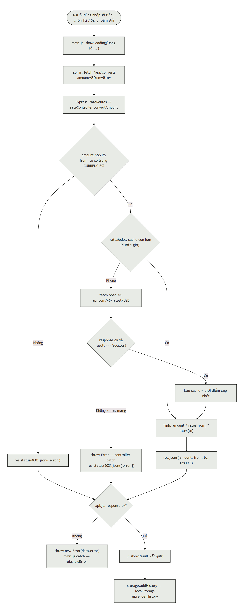

# Đổi Tiền: Ứng dụng chuyển đổi tiền tệ

Assignment môn **WEB2064, Lập trình JavaScript nâng cao**, đề **Cơ bản 2: Ứng dụng chuyển đổi tiền tệ**.

Ứng dụng cho phép quy đổi giữa 10 loại tiền tệ theo tỷ giá thật, xem bảng tỷ giá, lưu các cặp tiền yêu thích và xem lại lịch sử quy đổi.

- Link deploy: _(điền link Render sau khi deploy)_
- Link GitHub: https://github.com/cudaim23-wq/currency-converter

## 1. Tính năng

| Tính năng | Mô tả |
| --- | --- |
| Đổi tiền | Nhập số tiền, chọn tiền gốc và tiền đích rồi bấm **Đổi**. Kết quả lấy từ API qua `async/await`. |
| Hoán đổi | Nút ⇄ đảo chiều tiền gốc và tiền đích. |
| Bảng quy đổi | Hiện giá trị của 1 đơn vị tiền gốc theo 9 loại còn lại (dựng bằng `map`). Bảng tự cập nhật khi đổi tiền gốc. |
| Thời điểm cập nhật | Hiện thời điểm nguồn tỷ giá cập nhật lần gần nhất. |
| Yêu thích | Lưu cặp tiền hay dùng (không lưu trùng), bấm **Dùng** để điền nhanh, bấm **Xóa** để bỏ. |
| Lịch sử | Mỗi lần đổi thành công được lưu lại kèm thời gian, có nút **Xóa lịch sử**. |
| Trạng thái và lỗi | Hiện "Đang tải..." khi chờ API, hiện thông báo lỗi khi nhập sai hoặc API lỗi. |
| Lưu trữ | Yêu thích và lịch sử lưu ở `localStorage` nên tải lại trang vẫn còn. |

## 2. Công nghệ

- **Backend:** Node.js (ES modules), Express 5, tổ chức theo mô hình MVC: route nhận request, controller kiểm tra dữ liệu, model lấy và tính tỷ giá. Controller trả JSON thay cho view.
- **Frontend:** HTML, CSS, JavaScript ES6+ (module, class, arrow function, destructuring, spread, template string, `async/await`, Fetch API), đóng gói bằng Webpack.
- **Giao diện:** lấy cảm hứng từ hệ thiết kế của Wise (file `DESIGN.md`), font Inter.

## 3. Thư viện npm và lý do chọn

| Thư viện | Dùng ở | Lý do chọn |
| --- | --- | --- |
| `express` | backend | Tạo server và định tuyến API gọn, phổ biến, dễ học, hợp với kiểu MVC. Đồng thời phát luôn trang web đã build. |
| `webpack`, `webpack-cli` | frontend (dev) | Gộp các module ES6 (`main.js`, `api.js`, `ui.js`, `storage.js`, `models/`) thành một file JS đã nén, thêm mã băm vào tên file để trình duyệt không dùng bản cũ. |
| `html-webpack-plugin` | frontend (dev) | Sinh `dist/index.html` từ `index.html` và tự chèn thẻ `<script>`, `<link>` đúng tên file đã băm, kèm favicon. |
| `css-loader`, `mini-css-extract-plugin` | frontend (dev) | Cho phép `import "../styles/style.css"` trong JS và tách CSS ra file riêng để trang không bị nháy khi tải. |

Phần gọi API dùng `fetch` có sẵn trong Node 18+ và trình duyệt nên không cần cài thêm thư viện như axios.

## 4. API công khai

- Nguồn: **ExchangeRate-API (bản Open Access)**, `https://open.er-api.com/v6/latest/USD`
- **Không cần API key**, miễn phí.
- Dữ liệu dùng: `result` (kiểm tra `"success"`), `rates` (tỷ giá so với USD), `time_last_update_utc` (thời điểm cập nhật).
- Nguồn này chỉ cập nhật khoảng 1 lần mỗi ngày, nên backend **cache 1 giờ** để không gọi API mỗi lần người dùng bấm.
- Đổi chéo giữa hai loại tiền bất kỳ: `kết quả = số tiền / rates[từ] * rates[sang]` (đi qua USD làm gốc).

### API của backend (tự viết)

| Method | Đường dẫn | Trả về |
| --- | --- | --- |
| GET | `/api/currencies` | Danh sách 10 mã tiền tệ hỗ trợ |
| GET | `/api/convert?amount=100&from=USD&to=VND` | `{ amount, from, to, result }` |
| GET | `/api/rates/:base` | `{ base, rates: [{ ma_tien_te, ty_gia_so_voi_goc, thoi_diem_cap_nhat }] }` |

Lỗi trả về dạng `{ error: "..." }` với mã **400** (dữ liệu gửi lên sai) hoặc **502** (không lấy được tỷ giá từ API ngoài).

## 5. Dữ liệu (Y1)

| Dữ liệu | Thuộc tính | Lưu ở |
| --- | --- | --- |
| Tỷ giá (`Rate`) | `ma_tien_te`, `ty_gia_so_voi_goc`, `thoi_diem_cap_nhat` | Cache trong bộ nhớ backend |
| Yêu thích (`Favorite`) | `id`, `tu_tien_te`, `den_tien_te`, `thoi_gian` | `localStorage` key `favorites` |
| Lịch sử (`HistoryItem`) | `id`, `tu`, `den`, `so_tien`, `ket_qua`, `thoi_gian` | `localStorage` key `history` |

## 6. Cấu trúc thư mục

```
currency-converter/
├── package.json            # script build/start cho cả dự án (dùng khi deploy)
├── render.yaml             # cấu hình deploy Render
├── docs/flowchart.png      # sơ đồ luồng
├── backend/
│   ├── server.js           # khởi động Express, phát frontend/dist, gắn /api
│   └── src/
│       ├── config/currencies.js     # 10 mã tiền tệ hỗ trợ
│       ├── routes/rateRoutes.js     # định nghĩa đường dẫn API
│       ├── controllers/rateController.js  # kiểm tra input, trả JSON, bắt lỗi
│       └── models/
│           ├── Rate.js              # class Rate
│           └── rateModel.js         # gọi API ngoài, cache, tính quy đổi
└── frontend/
    ├── index.html          # khung trang
    ├── webpack.config.js
    ├── images/favicon.svg
    ├── styles/style.css
    └── src/
        ├── main.js         # gắn sự kiện, điều phối luồng (xử lý)
        ├── api.js          # gọi backend bằng fetch (api)
        ├── ui.js           # cập nhật giao diện (hiển thị)
        ├── storage.js      # đọc/ghi localStorage
        └── models/
            ├── Favorite.js
            └── HistoryItem.js
```

## 7. Cách chạy

Yêu cầu: Node.js 20.11 trở lên (dự án dùng `import.meta.dirname`).

**Cách nhanh (giống khi deploy):**

```bash
cd currency-converter
npm run build    # cài thư viện backend + frontend rồi build frontend ra frontend/dist
npm start        # chạy server
```

Mở http://localhost:3000

**Khi đang phát triển** (mở 2 terminal):

```bash
# Terminal 1: tự build lại frontend mỗi khi sửa file
cd currency-converter/frontend
npm install
npm run dev

# Terminal 2: server tự khởi động lại khi sửa backend
cd currency-converter/backend
npm install
npm run dev
```

## 8. Deploy (Render)

1. Đẩy code lên GitHub.
2. Vào https://render.com, chọn **New > Blueprint** rồi chọn repo (Render đọc file `render.yaml`).
   Hoặc chọn **New > Web Service** và điền: Build Command `npm run build`, Start Command `npm start`.
3. Render tự cấp biến `PORT`, server đã đọc `process.env.PORT`.

## 9. Sơ đồ luồng (Y5)



Mã nguồn sơ đồ (Mermaid) nằm ở `docs/flowchart.mmd`.

### Nếu API trả về lỗi hoặc rỗng thì sao?

- **Người dùng nhập sai** (ô trống, số âm, mã tiền không hỗ trợ): controller trả **400** kèm thông báo, frontend hiện lỗi màu đỏ, không lưu lịch sử.
- **API ngoài lỗi hoặc mất mạng:** `rateModel` kiểm tra `response.ok` và `result === "success"`, sai thì `throw`. Controller bắt bằng `try/catch` và trả **502** "Không lấy được tỷ giá, thử lại sau". Server không bị sập.
- **API trả dữ liệu thiếu** (không có tỷ giá của mã tiền cần đổi): model `throw` lỗi, xử lý giống trường hợp trên.
- **Frontend:** `api.js` kiểm tra `response.ok`, nếu sai thì `throw new Error(data.error)`. `main.js` bắt bằng `try/catch` và gọi `showError`. Bảng tỷ giá hiện dòng báo lỗi riêng.
- **localStorage rỗng:** `getFavorites`/`getHistory` trả mảng rỗng, giao diện hiện "Chưa có ...".
- Nhờ cache 1 giờ, server ít phụ thuộc API ngoài: trong 1 giờ sau lần gọi thành công, mọi yêu cầu đều dùng lại dữ liệu đã lưu mà không gọi API nữa.

## 10. Phần AI hỗ trợ

Dự án có dùng trợ lý AI (Cursor) trong quá trình học và làm bài:

- **Tự viết (có AI hướng dẫn và kiểm tra lỗi):** các class `Favorite`, `HistoryItem`; hàm `convertAmount` và `getRates` trong `rateController.js`; phần lớn logic `main.js`, `storage.js`, `ui.js`.
- **AI hỗ trợ viết hoặc sửa:** khung HTML/CSS theo `DESIGN.md`; phần gọi API ngoài và cache trong `rateModel.js`; cấu hình Webpack; script build/deploy; sơ đồ luồng và README này. AI cũng giúp sửa các lỗi như gọi `res.json` hai lần (`ERR_HTTP_HEADERS_SENT`), gán lại biến `const`, thông báo lỗi bị xóa mất.
- Mọi đoạn code AI hỗ trợ đều đã được đọc lại, chạy thử và có thể giải thích khi vấn đáp.
